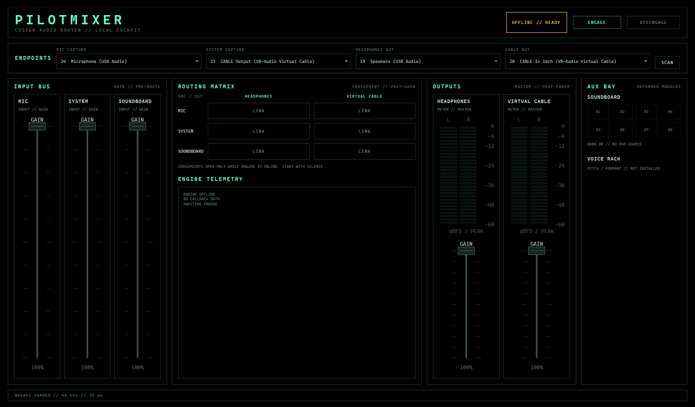

# The Audio Mixer That Doesn't Require an Audio Engineering Degree.

One Panel. Three Presets. No Audio Engineering Required.

A local, cockpit-style audio router and soundboard for Windows. PilotMixer is built with Python 3.11, PySide6, NumPy, SciPy, and PortAudio via `sounddevice`.



> **Status: early integration.** The shell, device selection, engine lifecycle, routing matrix, faders, meters, and telemetry are wired. Live routing is not production-ready: capture-ring contention currently drops frames while the engine is online. See [Known limitations](#known-limitations).

## What works

- WASAPI endpoint discovery with selectable microphone, system-capture, headphone, and virtual-cable devices.
- Engine start/stop on a dedicated, COM-initialized worker thread; the Qt thread never opens audio streams.
- Three source buses (`MIC`, `SYSTEM`, `SOUNDBOARD`) routed to two stereo outputs through a live crosspoint matrix.
- Custom-painted vertical faders and stereo peak-hold meters.
- Live engine telemetry for dropped capture frames, output underflows, clipping, and stream errors.
- Safe defaults: every route starts off; the engine can be stopped cleanly; no recording is performed.
- Deterministic unit tests for the mix/routing core and offscreen tests for the UI.

## Not implemented yet

- Soundboard pad playback and file loading.
- Voice mixer, voice changer, formant shifting, and key/scale pitch correction.
- Device hot-plug recovery, saved profiles, and packaged installers.
- Audible live-routing verification and end-to-end latency measurements.

The staged plan is in [ROADMAP.md](ROADMAP.md).

## Requirements

- Windows 11 x64
- Python 3.11 (the development environment uses pyenv; a `.venv` is not required)
- VB-Audio Virtual Cable (or equivalent virtual audio cable) for system-audio and Discord routing
- Packages pinned in [requirements.txt](requirements.txt)

## Setup and run

```bash
python -m pip install -r requirements.txt
python run.py
```

The first shell launch scans WASAPI endpoints but does not open any audio streams. Select the four endpoints and press **ENGAGE** when you are ready to start the engine.

For Discord/system-audio routing, use independent virtual cable paths for system capture and Discord delivery. Do not loop the same cable into itself.

## Tests

```bash
python -m unittest discover -s tests -v
```

The suite covers the deterministic mix path, ring-buffer behavior, soundboard resampling, service lifecycle, fader interaction, meter rendering, and shell state transitions.

## Repository map

| Path | Purpose |
| --- | --- |
| [audio_engine.py](audio_engine.py) | PortAudio/WASAPI streams, mix bus, routing matrix, soundboard clip path |
| [cockpit_widgets.py](cockpit_widgets.py) | Custom `VerticalFader` and stereo `VUMeter` |
| [engine_service.py](engine_service.py) | Threaded lifecycle, COM initialization, diagnostics bridge |
| [main_window.py](main_window.py) | Pilot Terminal shell and control wiring |
| [theme.py](theme.py) | Black/mint cockpit palette and Qt stylesheet |
| [run.py](run.py) | Application entry point |
| [tests/](tests) | Unit and offscreen UI tests |
| [docs/pilotmixer-shell.png](docs/pilotmixer-shell.png) | Current shell screenshot |
| [ROADMAP.md](ROADMAP.md) | Phased feature and verification plan |

## Known limitations

- **Capture drops are unresolved.** In a four-second live run, telemetry reported 15,360 dropped microphone frames and 3,840 dropped system frames. The output underflows were 9 and 13 and stopped growing after startup. Do not use this build for important live audio yet.
- **Startup is COM- and thread-sensitive.** PortAudio's WASAPI backend needs `CoInitializeEx` on the thread that starts the streams. That is handled by `engine_service.py`; keep engine lifecycle operations on that worker.
- **Python callbacks are soft real-time.** The audio callbacks avoid blocking locks, logging, and disk work, but Python and NumPy can still be delayed by the OS or GIL.
- **Live rate handling relies on WASAPI shared-mode conversion.** Soundboard clips are resampled with SciPy. If an endpoint rejects the requested engine rate, startup fails rather than silently changing format.
- **No automatic device recovery.** Unplugging a device or changing its Windows sample rate requires a stop/start.
- **No measurement claim.** Reported PortAudio latency is not an end-to-end acoustic or loopback measurement.
- **Output can clip.** A final sample clamp is applied; this is not a transparent limiter or a hearing-safety guarantee.

## License

This project is **source-available** under the PolyForm Strict License 1.0.0. You are free to use it for noncommercial purposes, but you may not modify, distribute, or reuse the code.
